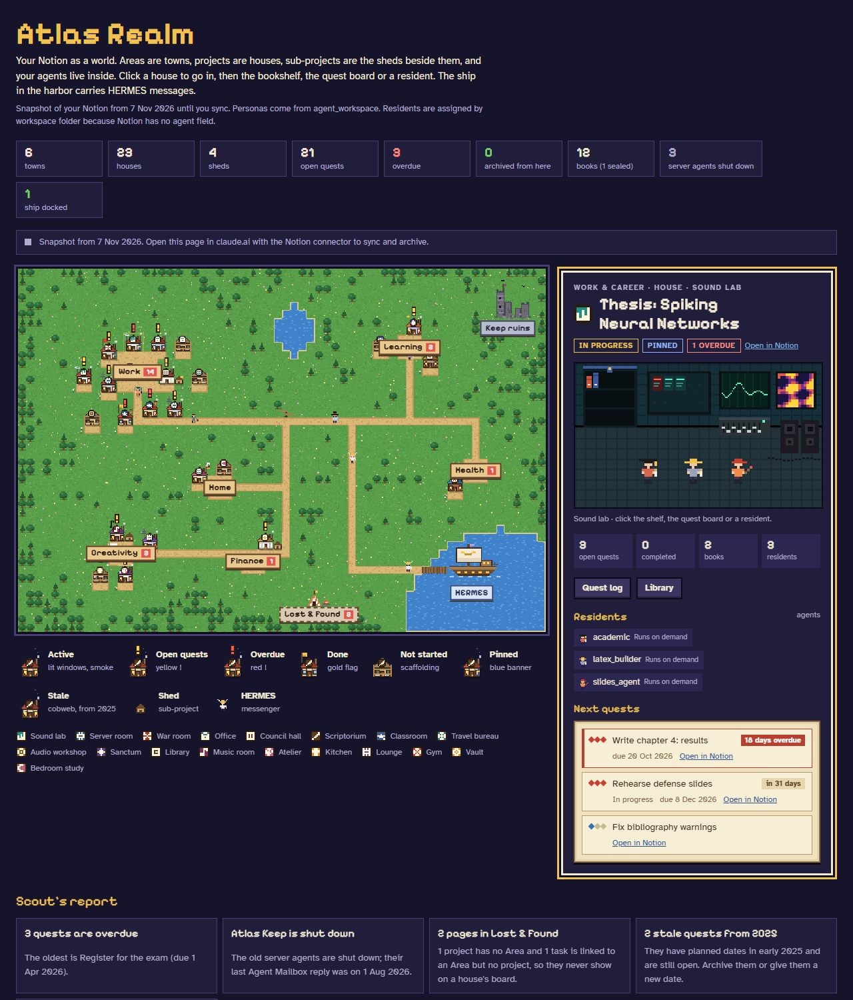

# Atlas Realm

**A pixel-art RPG view of a Notion workspace and the AI agents that work in it.**

Areas are towns, projects are houses (sub-projects are sheds), notes are books on the shelf, tasks are quests on the board, and the agents of a personal multi-agent assistant ("Atlas") are the residents. HERMES, the always-on server agent, is the ship in the harbor.

▶ **Live demo (fictional data):** https://arianabdl.github.io/atlas-realm/



## What it does

- **Map of your work.** Every project becomes a building whose style matches its topic (lab, library, gym, studio…). Open a house to see its quest board, bookshelf and residents.
- **Workspace health checks.** The *Findings* panel lists overdue quests, done-but-not-archived tasks, stale tasks, and pages lost without an Area.
- **Agents as characters.** Each agent has a sprite, an outfit and a character sheet built from its persona file (identity, rules, workflow, memory size).
- **Live Notion sync (inside claude.ai).** Published as a claude.ai artifact, the page reads Notion through the artifact `mcp` capability and the Notion connector, and can archive a task from its quest log (with undo).
- **Offline fallback.** Anywhere else it shows the snapshot in `src/world.js`. In this repo that snapshot is a **fictional demo world**.

## How it works

- **One HTML file, no libraries.** Map, sprites, interiors and panels are drawn on `<canvas>` with plain JavaScript.
- **Saved views first.** Reads go through saved Notion views (`src/views.json`); if a view fails, the page falls back to a custom query. It re-applies its own filters so an edited view can't leak pages.
- **Privacy filter.** Notes whose title matches a pattern are stored *sealed* (no title shown).
- **Per-browser memory.** Last sync and house positions are kept in `localStorage`.

## Layout

| Path | What it is |
|---|---|
| `src/template.html` | Markup, styles and all page logic (layout, drawing, panels, sync) |
| `src/themes.js` | Building types, interiors and agent outfits |
| `src/world.js` | Snapshot used before the first sync (**fictional demo data**) |
| `tools/sync_notion.py` | Pulls your own Notion into `src/world.local.js` with your token |
| `.env.example`, `config.example.json` | Templates for your token and database settings |
| `src/views.json` | Links to your saved Notion views (empty here) |
| `src/personas.json` | Agent character sheets (demo here; generate yours with `tools/parse_personas.py`) |
| `build.py` | Inlines everything into `dist/atlas_realm.html` and `docs/index.html` |
| `tests/mock.html` | Stand-in for the claude.ai runtime and Notion (fake rows, paging, forced failures) |

## Build and test

```bash
python build.py
node --check dist/check.js
cat tests/mock.html dist/atlas_realm.html > dist/test.html
python -m http.server 8765 --bind 127.0.0.1   # open http://127.0.0.1:8765/dist/test.html
```

In the test page console, `window.__failView = true` forces the backup query, and `localStorage.mockGrant = "granted"` simulates Notion already being allowed.

## Use it with your own Notion

### Option A — on your computer, with your own Notion token
Your token stays on your machine: it lives in `.env` (git-ignored) and is only used by the sync script to call the Notion API. It is never written into the page.

1. Create an internal integration at [notion.so/profile/integrations](https://www.notion.so/profile/integrations) and copy its secret.
2. Share your **Areas**, **Projects**, **Tasks** and (optional) **Notes** databases with the integration (database → `…` → *Connections*).
3. Set up the two local files:
   ```bash
   cp .env.example .env                  # paste NOTION_TOKEN=...
   cp config.example.json config.json    # paste your database IDs, check property names
   ```
4. Sync and build:
   ```bash
   python tools/sync_notion.py           # -> src/world.local.js
   python build.py                       # -> dist/atlas_realm.local.html
   ```
5. Open `dist/atlas_realm.local.html` in your browser. Run the two commands again whenever you want fresh data.

Your Areas become the six towns, in the order you give in `config.json → areas.order` (the first one gets the big town). `agents_by_keyword` decides which agent characters live in which house.

All `*.local.*` files, `.env` and `config.json` are git-ignored, and the local build never touches the public demo in `docs/`.

### Option B — live inside claude.ai (no token)
Publish the page as a claude.ai artifact with the Notion connector; it then syncs and archives tasks live. Put your data source IDs and saved view links in `config.json → claude_ai`, run `python build.py`, and publish `dist/atlas_realm.html`. Live mode expects the property names described in the [Atlas Agent OS Notion schema](https://github.com/Arianabdl/atlas-agent-os/blob/main/docs/notion_schema.md).

### Agent character sheets
If you keep agent persona files, `python tools/parse_personas.py` reads them into `src/personas.local.json` (git-ignored) for the next build.

## License

MIT
